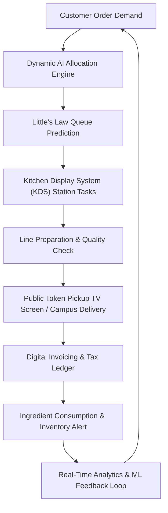

# 🍽️ Smart Canteen Operations & AI Queue Allocation Platform

> **Commercial-Grade, AI-Powered Intelligent Canteen Operations, Queue Prediction, Order Allocation, Billing, Inventory, Kitchen & Delivery SaaS Platform**

[](https://nodejs.org/)
[](https://react.dev/)
[](https://www.typescriptlang.org/)
[](https://python.org/)
[](https://fastapi.tiangolo.com/)
[](https://tailwindcss.com/)
[](https://socket.io/)

---

## 🌟 Executive Overview

Smart Canteen is an end-to-end food operations platform designed for corporate campuses, universities, hospital networks, and tech parks. Going far beyond simple CRUD ordering, the platform continuously operates a **closed-loop AI intelligence cycle**:



---

## 👥 Demo Accounts & One-Click Role Switcher

The application features a **Global Role Switcher Quick Bar** in the navigation header, allowing instant 1-click role transitions without manual login:

| Role | Name & Title | Email | Password | Primary Capabilities |
| :--- | :--- | :--- | :--- | :--- |
| **CUSTOMER** | Ananya Roy (Software Engineer) | `customer@demo.local` | `demo123` | Interactive menu, live order tracker stepper, AI wait countdown, cart drawer, digital tax invoice, customer AI assistant. |
| **KITCHEN_STAFF** | Chef Rajesh Sharma (Head Chef) | `kitchen@demo.local` | `demo123` | Large-screen KDS, station filters (Grill, Fry, South/North Indian, Beverage, Bakery), subtask checklist, delay alerts, one-click prep & ready toggles. |
| **CANTEEN_MANAGER** | Vikram Malhotra (Ops Manager) | `manager@demo.local` | `demo123` | Real-time queue congestion monitor, workstation load meters, actionable AI recommendations with 1-click apply, "What-If" scenario sandbox. |
| **CASHIER** | Pooja Nair (POS Cashier) | `cashier@demo.local` | `demo123` | High-speed walk-in counter POS terminal, quick-tap item grid, cash/card/UPI toggle, instant token generation. |
| **DELIVERY_AGENT** | Arjun Das (Campus Runner) | `delivery@demo.local` | `demo123` | Campus desk delivery dispatch, drop-off routing, runner handover confirmation. |
| **INVENTORY_MANAGER** | Manoj Kumar (Stock Lead) | `inventory@demo.local` | `demo123` | Live ingredient stock levels, low-stock threshold warning badges, quick manual stock adjustment ledger. |
| **ADMIN** | Sarah Jenkins (Platform Admin) | `admin@demo.local` | `demo123` | Executive SaaS BI dashboard, revenue trends, peak hour order distributions, top 5 revenue drivers, station performance. |

---

## 🏗️ Architectural Topology

```
canteen/
├── apps/
│   ├── web/                 # React 18 + Vite + Tailwind CSS + Recharts + Lucide Icons
│   ├── api/                 # Express.js + TypeScript REST & WebSocket Server
│   ├── ai-service/          # Python 3.11 FastAPI Microservice + Scikit-Learn ML Models
│   └── worker/              # Background Task Processor (SLA Monitor & Load Balancer)
├── packages/
│   └── shared/              # Shared TypeScript domain types, enums and socket events
├── database/
│   ├── seed/                # Seeding engine with 5,200+ historical orders and catalog
│   └── fixtures/            # Persistent transactional JSON datastore snapshot
├── scripts/
│   ├── run-dev.js           # Concurrent orchestrator for all 3 microservices
│   ├── simulate-traffic.js  # Real-time customer order traffic generator
│   └── test-e2e.js          # Full-system end-to-end integration acceptance test
├── docker-compose.yml       # Production multi-container containerization
├── package.json             # Monorepo root workspace configuration
└── README.md
```

---

## ⚡ Quick Start & Commands

### 1. Installation
```powershell
# Install all node monorepo dependencies
cmd /c "npm install"
```

### 2. AI Model Training & Dataset Synthesis
Generates 12,000 realistic historical records and trains GradientBoosting and RandomForest regressors:
```powershell
cmd /c "npm run seed:ai"
```
*Wait Time Model R² Score: **0.973** (RMSE 1.63 min)*  
*Prep Time Model R² Score: **0.976** (RMSE 1.37 min)*

### 3. Seed Database
Populates organizations, canteens, stations, staff, menus, inventory, coupons, and 5,200 historical orders:
```powershell
cmd /c "npm run seed"
```

### 4. Run Development Suite
Boots the Python AI Service (Port 8000), Express API (Port 5000), and React Frontend (Port 3000) concurrently:
```powershell
cmd /c "npm run dev"
```

- **Web Frontend**: [http://localhost:3000](http://localhost:3000)
- **Backend API**: [http://localhost:5000](http://localhost:5000)
- **AI Microservice**: [http://localhost:8000](http://localhost:8000)
- **API Health**: [http://localhost:5000/health](http://localhost:5000/health)

---

## 🧪 Automated Testing & Simulation

### Automated Backend Unit & Integration Tests
```powershell
cmd /c "npm test"
```

### Real-Time Live Order Simulator
Submits realistic customer orders at runtime to demonstrate real-time queueing, AI allocation, and kitchen updates:
```powershell
cmd /c "npm run simulate"
```

### End-to-End Acceptance Test (E2E)
Validates the complete customer checkout, dynamic station allocation, KDS preparation, pickup screen, invoice retrieval, and analytics cycle:
```powershell
cmd /c "npm run test:e2e"
```

---

## 📺 Dedicated Public Display Modes

- **Public TV Pickup Screen**: High-contrast TV mode showing **NOW PREPARING** and **READY FOR PICKUP** token numbers with chime sound indicators. Accessible via the **"TV Display"** button in the header navigation or the `Ctrl+K` command center.
- **Global Command Center (`Cmd+K` / `Ctrl+K`)**: Instant searchable modal for rapid item lookups, role switching, and simulation triggers.

---

## 🔒 Security & Data Integrity
- JWT authentication with Bearer tokens and bcrypt password hashing.
- Role-Based Access Control (RBAC) middleware for all privileged endpoints.
- Modular payment abstraction with mock UPI, Card, Cash, and Corporate Allowance providers.
- Strict order state transitions preventing arbitrary status tampering.
