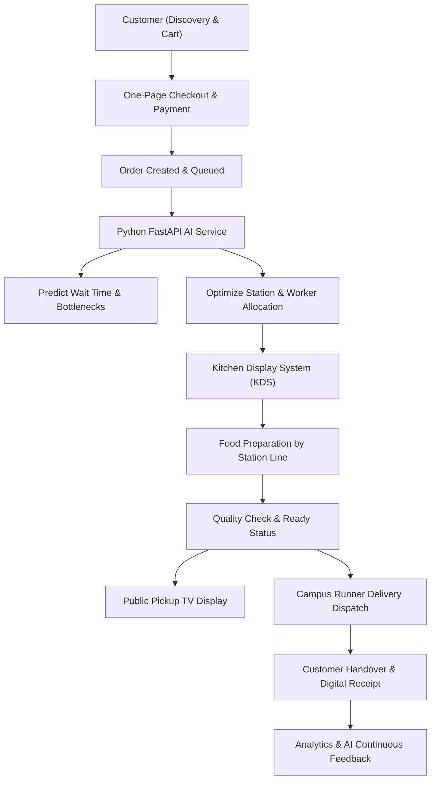

# Smart Canteen Architecture Documentation

## 1. System Overview

The **AI-Powered Intelligent Canteen Operations & Order Fulfillment Platform** is an enterprise-grade solution that manages the complete food-service lifecycle:

---

## 2. Dynamic Station Allocation & Little's Law Queue Engine

Incoming orders are dynamically decomposed into station tasks across the kitchen work stations:
- **South Indian Counter** (Dosas, Idlis, Vadas)
- **Grill & Sandwich Station** (Burgers, Wraps, Paninis)
- **Fry & Crispy Station** (Fries, Snacks)
- **North Indian Counter** (Curries, Breads, Meals)
- **Beverage & Brew Bar** (Cold Brews, Specialty Teas)
- **Bakery & Patisserie** (Croissants, Pastries)

### Mathematical Formulation
The queue wait time is predicted using a combination of Little's Law queuing dynamics and trained Scikit-Learn Gradient Boosting regressors:

$$W_q = \frac{L_q}{\mu \cdot S_{active}} \times M_{rush} \times M_{workload}$$

Where:
- $L_q$: Current queue length
- $\mu$: Average station processing rate per staff member
- $S_{active}$: Active on-duty line chefs
- $M_{rush}$: Rush hour congestion multiplier (Breakfast 1.15x, Lunch 1.35x - 1.6x)
- $M_{workload}$: Workstation saturation factor

---

## 3. Microservice Network Architecture

- **`apps/web` (Port 3000)**: React 18, Vite, TypeScript, Tailwind CSS, Lucide icons, Recharts, Socket.IO client.
- **`apps/api` (Port 5000)**: Node.js, Express, TypeScript, Socket.IO server, Dual-mode transactional data repository, JWT authentication, RBAC.
- **`apps/ai-service` (Port 8000)**: Python 3.11, FastAPI, Scikit-Learn (Gradient Boosting & Random Forest models), synthetic dataset generator (12,000+ historical orders).
- **`apps/worker`**: Background job processor for SLA monitoring and kitchen rebalancing.
